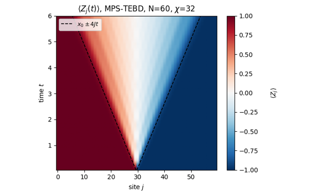

{width=60% fig-align=center fig-alt="Tensor networks"}

Matrix product states store a weakly entangled state of a long chain with memory that grows linearly in its
length. The notebook constructs them from repeated singular value decompositions, explains canonical forms and
truncation, and builds two-site DMRG from its elements: the Hamiltonian as a matrix product operator, the
environments, the effective Hamiltonian applied matrix-free, Lanczos as the local solver, and the sweeps.

Time evolution follows with a compiled TEBD two-site update at fixed bond dimension, validated against
state-vector evolution and then applied to quenches of chains far longer than a state vector can hold.

Notebook 18 is the core of the chapter. Its Sections 2–5 (why entanglement decides compressibility, the construction, canonical
forms, truncation, measurements) are needed for everything else; Section 6 (DMRG) and Sections 7–10 (TEBD, quenches of
40 and 60 spins and the entanglement barrier) are independent of each other and can be read in either order; Sections
11–12 give the cost and the limits of the method. Prerequisites are notebooks 01 and 02 (`jit`, `vmap`, `lax.scan`,
einsum and tensor-leg diagrams) of [Chapter 1](ch01_computational_toolbox.qmd); the Schmidt decomposition, the
entanglement entropy and the area law of notebook 06 in [Chapter 3](ch03_matrix_free_engine.qmd); and, in
[Chapter 5](ch05_ground_states_and_unitary_dynamics.qmd), the Lanczos algorithm of notebook 11 (for DMRG), the
Trotter–Suzuki gates of notebook 12 (for TEBD) and, helpful for the physics of the quenches, notebook 15. DMRG returns
for the critical Ising chain in [Chapter 11](ch11_quantum_phase_transitions.qmd).

The companion notebook 18b repeats the central calculations with an established tensor-network library, TeNPy
(`pip install physics-tenpy`; the notebook installs it when it is missing). It derives the dictionary between the
conventions of the two codes and tests it on the full Hamiltonian matrix, compares DMRG ground states of the
transverse-field Ising and XXZ chains and TEBD quenches of the XX chain, grades both codes against exact free-fermion
solutions, and shows what the agreement of two codes proves and what it does not. It assumes Sections 2–10 of notebook 18.

## Notebooks in this chapter

::: {.nb-item}
[Beyond the state vector — matrix product states, DMRG and TEBD](../ch07_tensor_networks/18_mps_tebd.ipynb)

Matrix product states from repeated SVDs, canonical forms and truncation, ground states by two-site DMRG (MPO, environments, effective Hamiltonian, Lanczos, sweeps), a jit-compiled TEBD two-site update with static (zero-padded) bond dimension, validation against state-vector TEBD, and quenches of 40-60 spins that no state vector can hold.
:::

::: {.nb-item}
[Cross-checking the MPS engine against TeNPy — conventions, DMRG and TEBD](../ch07_tensor_networks/18b_engine_vs_tenpy_cross_check.ipynb)

The MPS engine against the tensor-network library TeNPy: the convention dictionary, DMRG of the Ising and XXZ chains, TEBD quenches graded by exact free-fermion solutions, and what agreement between two codes proves.
:::

