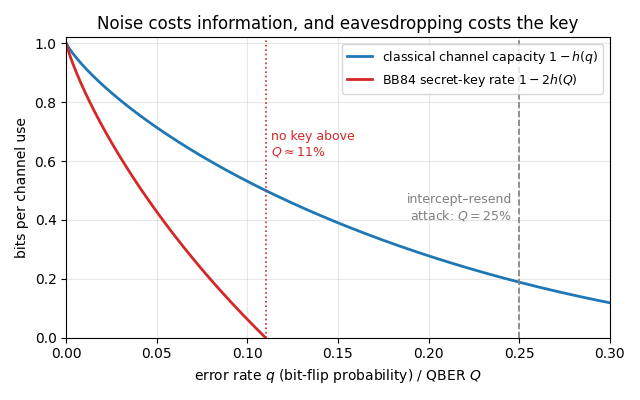

{width=60% fig-align=center fig-alt="Quantum machine learning"}

Quantum machine learning uses a quantum system as a trainable model. Data enter through the preparation of a state or
through the drive of a Hamiltonian, the output is read from expectation values or measurement statistics, and a
classical optimiser adjusts the free parameters. The models differ in where the trainable parameters sit. In a
variational quantum circuit they are the angles of the gates; in a quantum reservoir the quantum dynamics stays fixed
and only a classical linear readout is trained; in a data re-uploading classifier the input itself is written into the
circuit again and again, between trainable layers. Because the simulator is differentiable, all three are trained with
the same code that evolves a spin chain.

**Variational quantum circuits.** A variational quantum algorithm adjusts the angles of a parametrised circuit to
minimise a cost function. Notebooks 40 to 42 derive four ways to obtain gradients (finite differences, the
parameter-shift rule, SPSA and automatic differentiation), compare optimisers from plain gradient descent to the
quantum natural gradient, and apply them in the variational quantum eigensolver to ground states of spin chains,
checked against exact diagonalisation.

The remaining variational notebooks address what a real device adds: the number of measurements a cost evaluation
needs, including classical shadows inside the optimisation loop; gate noise and its effect on landscapes, training and
error mitigation. The same machinery then optimises probe states for quantum metrology, compresses quantum data in
the quantum autoencoder and uses its compression cost to locate phase boundaries without labels, and classifies data
with quantum kernels. The quantum approximate optimisation algorithm turns it to classical problems: MaxCut and number
partitioning become diagonal Ising Hamiltonians, and alternating cost and mixer layers are trained to sample their
optimal bit strings.

Read notebooks 40 and 41 first; every other variational notebook uses their gradients and optimisers. The eigensolver
follows in the order 42a, 42, 43: notebook 42a introduces the Hamiltonians, the ansätze and the training, notebook 42
the error relations, symmetries, excited states and shot noise, and notebook 43 the measurement cost. Notebook 44 takes
the eigensolver as given, so read it after the eigensolver notebooks, although it is listed with the foundations. The
applications can then be read in any order: notebook 44b builds on notebook 44 and needs notebooks 29 to 34 and 37 of
[Chapter 10](ch10_quantum_metrology_protocols.qmd); notebook 45 uses the noise models of notebook 44 in its Section
12; notebook 45b builds on notebook 45, and its Sections 3.1 and 6.4 use the fidelity susceptibility and the
Kosterlitz–Thouless point of notebook 47 in [Chapter 11](ch11_quantum_phase_transitions.qmd); notebook 45c needs
notebooks 40 to 42; notebook 45d needs none of the earlier notebooks of the chapter. Prerequisites are notebook 01
(JAX: `jit`, `vmap`, `grad`, `lax.scan`) of [Chapter 1](ch01_computational_toolbox.qmd); the state tensors, density
tensors, channels and measurements of notebooks 05 to 08 in [Chapter 3](ch03_matrix_free_engine.qmd); the gates and
random circuits of notebooks 09 and 10 in [Chapter 4](ch04_digital_quantum_circuits.qmd); the Hamiltonians and Lanczos
ground states of notebook 11, and the Trotter splitting of notebook 12 for notebook 45c, in
[Chapter 5](ch05_ground_states_and_unitary_dynamics.qmd); and the classical shadows of notebook 24 in
[Chapter 8](ch08_quantum_information_protocols.qmd) for notebook 43.

**Quantum reservoir computing.** In quantum reservoir computing (notebook 46) the many-body dynamics itself is left
untrained: an input sequence is written into a spin system, the Hamiltonian evolution acts as a nonlinear feature map
with fading memory, and only a linear readout is fitted by ridge regression. The notebook measures the memory capacity
of the reservoir, applies it to standard benchmark tasks against classical baselines tuned on the same validation
data, and compares density-tensor and trajectory simulations under finite measurement statistics and decoherence. At
equal feature count the four-qubit reservoir has a larger error than the tuned classical echo-state network on every
task.

Notebook 46 first introduces classical reservoir computing (the echo-state network, the ridge-regression readout,
memory capacity and the benchmark tasks), so no machine-learning background is needed, and it does not depend on the
variational notebooks. Its prerequisites are notebook 01 (`jit`, `vmap`, `lax.scan`, random keys) of
[Chapter 1](ch01_computational_toolbox.qmd); density tensors, partial traces, Kraus channels and measurement with
reset, notebooks 07 and 08 in [Chapter 3](ch03_matrix_free_engine.qmd); the Trotter–Suzuki gates of notebook 12 in
[Chapter 5](ch05_ground_states_and_unitary_dynamics.qmd); and the Lindblad equation and quantum trajectories of
notebooks 16 and 17 in [Chapter 6](ch06_open_quantum_systems.qmd), used in Sections 4.5 and 10.

**Data re-uploading classifier.** A classifier built from a single qubit becomes expressive when the classical input
is encoded into the circuit repeatedly, each encoding followed by a trainable rotation. Notebook 55
develops this model on one qubit and on a few qubits, with and without entanglement, and shows that $L$ encodings make
the output a Fourier series of degree $L$ in the data. It needs the Adam optimiser and the training loop of notebooks
40 and 41, notebook 01 (`jit`, `vmap`, `grad`, `lax.scan`) of [Chapter 1](ch01_computational_toolbox.qmd), the Bloch
vectors, fidelities and reduced density matrices of notebook 06 in [Chapter 3](ch03_matrix_free_engine.qmd), and the
rotations and the CZ gate of notebook 09 in [Chapter 4](ch04_digital_quantum_circuits.qmd).

**Physics-inspired machine-learning models.** The tools of many-body physics also build classical models. Notebook 56
maps every image to a product state of one qubit per pixel and stores the weight tensor of a linear classifier on these
$2^{196}$-dimensional states as a matrix product state with a label index. It trains the model on handwritten digits
by DMRG-like sweeps and by automatic differentiation of the whole contraction, and compares the entanglement of the
trained classifier with that of the superposition of its training images. It needs the matrix product states, the
singular value decomposition and the Schmidt values, the canonical forms and truncation, and the two-site DMRG sweeps of
notebook 18 in [Chapter 7](ch07_tensor_networks.qmd), gradient descent and the Adam optimiser of notebook 41, the tensor-leg diagrams of notebook 02 and notebook 01 (`jit`, `vmap`, `grad`, `lax.scan`) of
[Chapter 1](ch01_computational_toolbox.qmd).

Notebook 57 turns the same matrix product state into a generative model. The probability of a binary image is the
squared amplitude of the state, the Born rule, so the normalisation follows from the canonical form and new images are
drawn exactly, pixel by pixel, without a Markov chain. The notebook trains the model by two-site sweeps on the negative
log-likelihood, learns the bars-and-stripes data set exactly and relates the bond dimensions it needs to the Schmidt
ranks of the data, and on handwritten digits generates samples, completes images with missing pixels and measures the
gap between training and test likelihood. It builds on notebook 56 and needs the same prerequisites, together with the sampling of bit strings from a state
vector of notebook 08 in [Chapter 3](ch03_matrix_free_engine.qmd).

## Notebooks in this chapter

### Foundations: parametrised circuits, gradients, optimisers and noise

::: {.nb-item}
[Parametrized gates and gradients — differentiating a quantum circuit four ways](../ch13_quantum_machine_learning/40_parametrized_gates_and_gradients.ipynb)

What a variational quantum algorithm is, how parametrized gates and ansätze are built from Pauli exponentials, why the cost along one angle is a pure sinusoid, and four ways to get its gradient — finite differences, the parameter-shift rule, SPSA and reverse-mode automatic differentiation — with measured accuracy, cost, shot-noise behaviour and the barren-plateau variance scaling.
:::

::: {.nb-item}
[Optimisers for variational circuits — update rules and a benchmark on GHZ preparation and the Ising chain](../ch13_quantum_machine_learning/41_optimizers.ipynb)

Gradient descent, heavy-ball momentum, Adam, SPSA with Spall's gain sequences, the SPSA–Adam hybrid and the quantum natural gradient, each derived from its update equation, compiled into lax.scan training loops, vmapped over random initialisations, and benchmarked on GHZ state preparation and on the ground energy of a transverse-field Ising chain with exact and shot-noisy costs.
:::

::: {.nb-item}
[Noisy variational circuits — landscapes, plateaus, training and error mitigation](../ch13_quantum_machine_learning/44_noisy_variational_circuits.ipynb)

Gate noise as a channel after every rotation pair and every two-qubit gate, the dictionary between measured error rates and channel parameters, two exact-in-expectation simulators (density tensor and quantum trajectories) shown to agree, the contraction of the cost landscape derived and measured, the exact invariance of the minimum under global depolarising noise and its shift under local and non-unital noise, noise-induced barren plateaus, training with density-tensor gradients against SPSA on trajectory costs, optimal-parameter resilience, the depth trade-off and zero-noise extrapolation.
:::

### Variational quantum eigensolver

::: {.nb-item}
[The variational quantum eigensolver — spin-chain Hamiltonians, circuit ansätze and training against exact diagonalisation](../ch13_quantum_machine_learning/42a_variational_quantum_eigensolver_hamiltonians_ansatze_training.ipynb)

The transverse-field Ising and XXZ chains as sums of Pauli strings measured in two or three bases, their exact ground states by diagonalisation, four circuit ansätze (hardware-efficient, Hamiltonian-variational, and staircase and brick-wall circuits of general two-qubit blocks), Adam training with energy, fidelity, entanglement, magnetisations and correlators recorded against the exact values during training, the gradient variance of the energy over random angles from two to ten qubits and the shot count it implies, and warm-started scans across both phase diagrams.
:::

::: {.nb-item}
[The variational quantum eigensolver — ground states of spin chains from a trained circuit](../ch13_quantum_machine_learning/42_variational_quantum_eigensolver.ipynb)

The Rayleigh-Ritz principle proved, the error relations a practitioner needs (energy error second order in the state error, and bounded below by the gap times the infidelity), and the full VQE loop applied to XXZ, XY and transverse-field Ising chains: energy, fidelity, entanglement, magnetisations and bond correlators against Lanczos, depth and symmetry studies, the phase diagram, an excited state by deflation, and a shot-noise comparison at equal measurement budget.
:::

::: {.nb-item}
[VQE with classical shadows — the measurement cost of a variational algorithm](../ch13_quantum_machine_learning/43_vqe_with_classical_shadows.ipynb)

Term-by-term estimation, qubit-wise-commuting grouping and classical shadows compared by the number of runs of a quantum machine one VQE iteration needs, through their exact estimator variances at a fixed shot budget and verified by simulation; then shadow-estimated energies inside the optimisation loop, the bias that noisy cost estimates inject into the answer, and a full shadow characterisation of the converged state with bootstrap error bars.
:::

### Quantum autoencoder and unsupervised discovery of phase boundaries

::: {.nb-item}
[The quantum autoencoder — compressing quantum data with a variational circuit](../ch13_quantum_machine_learning/45_quantum_autoencoder.ipynb)

The encoder–trash–decoder construction, the exact relation between trash fidelity and reconstruction fidelity, the eigenvalue criterion that says exactly how well an ensemble can be compressed, compared with what training reaches, the Schmidt-rank picture of compressibility tested against it, two executions of the compression channel (exact partial trace and measure-and-reset trajectories) that give the same channel, training with automatic differentiation and with SPSA on trajectory estimates, generalisation to unseen inputs, and the effect of gate noise.
:::

::: {.nb-item}
[Unsupervised discovery of phase boundaries with a quantum autoencoder](../ch13_quantum_machine_learning/45b_quantum_anomaly_detection_phase_boundaries.ipynb)

A quantum autoencoder trained on the ground state at one point of the XXZ chain in a transverse field is applied, without retraining, to the ground states of the whole parameter plane. Its local trash cost maps the region of states the frozen encoder can still compress; the map is compared with exact observables, with untrained encoders and with other reference points.
:::

### Variational quantum metrology

::: {.nb-item}
[Variational quantum metrology — optimising probe states and measurements under noise with automatic differentiation](../ch13_quantum_machine_learning/44b_variational_quantum_metrology.ipynb)

A probe-preparation circuit trained by gradient ascent on the quantum Fisher information of its noisy output: an eigendecomposition-free gradient of the mixed-state QFI derived from a variational formula, the Heisenberg limit recovered without noise, optimised probes under local dephasing, amplitude damping and particle loss compared with fairly tuned GHZ, product and one-axis-twisted probes, the anatomy of the optimal states, and readout circuits trained on the classical Fisher information of the measured bit strings.
:::

### Quantum approximate optimisation

::: {.nb-item}
[The quantum approximate optimisation algorithm — MaxCut and number partitioning on graphs of up to ten vertices](../ch13_quantum_machine_learning/45c_quantum_approximate_optimisation.ipynb)

Binary optimisation problems written as diagonal Ising Hamiltonians, the QAOA circuit simulated with the cost layer as one phase per bit string, the depth-one expectation value in closed form for any unweighted graph and checked against simulation, gradients by automatic differentiation and by a gate-level parameter-shift rule, the approximation ratio and the probability of the optimal cut up to depth six, interpolation-based initialisation, the Trotterised-annealing limit, parameter transfer between graphs, and sampling against classical baselines.
:::

### Quantum kernel methods

::: {.nb-item}
[Quantum kernel methods — classifying data with a quantum feature map and a support vector machine](../ch13_quantum_machine_learning/45d_quantum_kernel_methods_classification.ipynb)

Two-dimensional data on concentric rings are encoded into up to ten qubits by a circuit of Hadamard, Rz and ZZ gates; the overlaps of the encoded states form a kernel matrix that a support vector machine, solved in JAX from its dual problem, turns into a classifier. The notebook measures the kernel by the inversion and swap tests, projects the data by kernel principal component analysis, compares accuracies with tuned classical kernels over random splits, and quantifies the concentration of kernel values with the number of qubits and the cost of finite shots.
:::

### Quantum reservoir computing

::: {.nb-item}
[Quantum reservoir computing — many-body dynamics as a machine for time series](../ch13_quantum_machine_learning/46_quantum_reservoir_computing.ipynb)

A driven many-body spin system as a trainable machine: input injection by qubit reset (a replacement channel), Hamiltonian dynamics between injections as a feature map with fading memory, ridge-regression readout, memory capacity and its finite-data bias, NARMA and Santa Fe laser prediction against tuned classical baselines, density tensor versus trajectories, finite measurement statistics and decoherence.
:::

### Data re-uploading classifier

::: {.nb-item}
[Data re-uploading — a universal quantum classifier from a single qubit](../ch13_quantum_machine_learning/55_data_reuploading_classifier.ipynb)

A single qubit that receives the data once separates classes only by a plane through the Bloch sphere; uploading the data $L$ times between trainable rotations turns it into a classifier for curved and non-convex regions. The notebook builds the protocol piece by piece in JAX (rotation layers $U(\boldsymbol\theta_i+\mathbf w_i\circ\mathbf x)$, maximally orthogonal label states, the fidelity and weighted fidelity costs, Adam training with vmap over random starts), compares test accuracies with the published tables, extends the classifier to two and four qubits with and without CZ entanglers, and shows that $L$ uploads make the output a Fourier series with frequencies up to $L$.
:::

### Physics-inspired machine-learning models

::: {.nb-item}
[Tensor networks as machine-learning models](../ch13_quantum_machine_learning/56_tensor_networks_for_machine_learning.ipynb)

A classical image classifier built from the tools of quantum many-body physics: every image becomes a product state of one qubit per pixel, and the weight tensor of a linear model on these $2^{196}$-dimensional states is stored as a matrix product state with a label index. The notebook trains it on MNIST in two ways, by DMRG-like sweeps with a gradient step on a two-site bond tensor and an SVD split, and by reverse-mode automatic differentiation of the whole contraction with Adam; it checks that the gradient of a contraction is its environment, measures accuracy against bond dimension and training-set size, compares with published results, and shows that the trained classifier is far less entangled than the superposition of its training images.
:::

::: {.nb-item}
[The matrix product state Born machine](../ch13_quantum_machine_learning/57_mps_born_machine.ipynb)

Unsupervised generative modelling with a matrix product state: binary images become basis states of one qubit per pixel, and the probability of an image is the squared amplitude of a many-body wave function, normalised exactly by a contraction. The notebook trains the state by two-site sweeps on the negative log-likelihood with an SVD split that adapts the bond dimensions, draws independent samples pixel by pixel without a Markov chain, learns the bars-and-stripes data set exactly (with bond dimensions that depend on the signs the amplitudes acquire), and on binarised MNIST measures training and test likelihoods against an independent-pixel baseline, overfitting, generated digits, the reconstruction of missing pixels and the entanglement of the learned state.
:::

